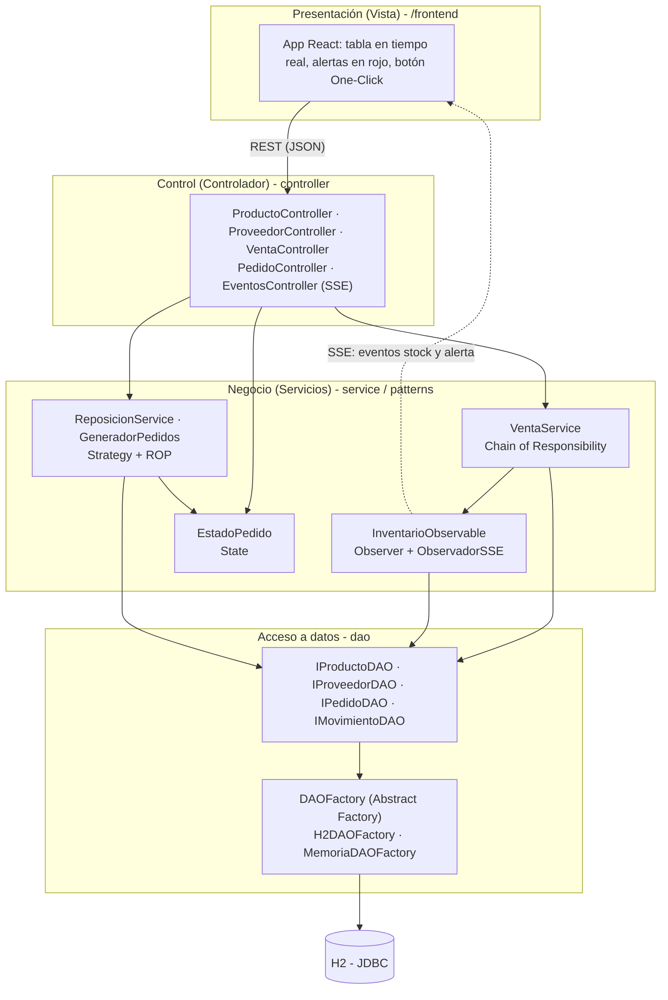

# Arquitectura en capas (N-Tier + MVC)

El front en React es la Vista; los controladores REST son el Controlador; los servicios y patrones
son el Modelo de negocio. El front y el back se comunican solo por REST y SSE.

