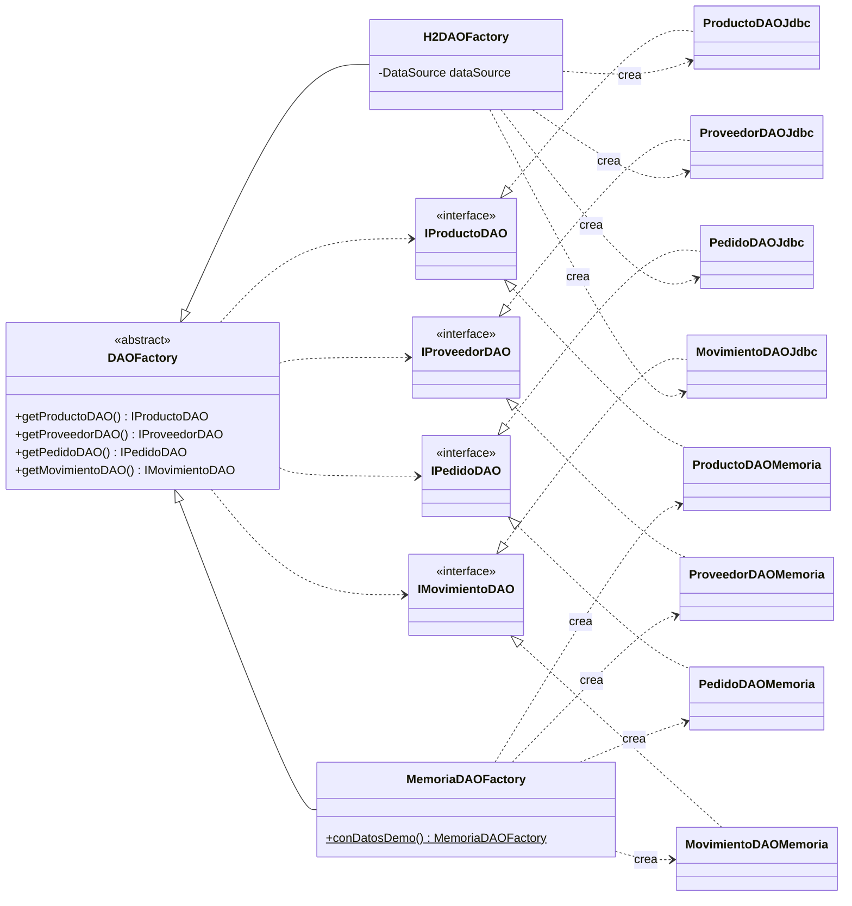
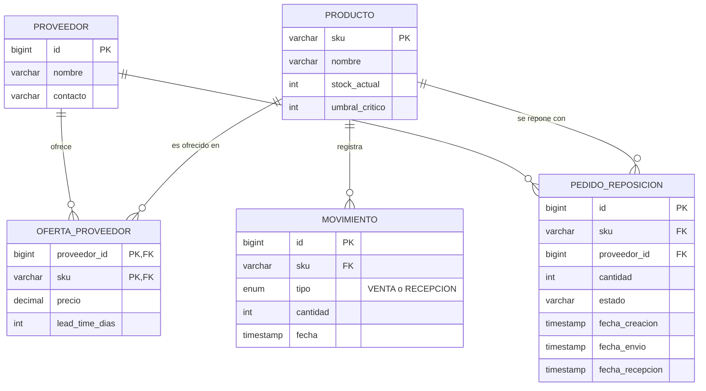

# DAO y Abstract Factory: persistencia y modelo de datos

**Autor:** Nicolás Facendini

## Problema

El negocio (ventas, reposición, estados del pedido) necesita leer y guardar productos, proveedores,
pedidos y movimientos, pero no debería saber si los datos viven en H2, en otra base o en memoria.
Si los servicios armaran sus propias consultas JDBC, cambiar de motor obligaría a reescribirlos.

## Solución

Dos patrones combinados:

- **DAO:** una interfaz por entidad (`IProductoDAO`, `IProveedorDAO`, `IPedidoDAO`, `IMovimientoDAO`)
  que esconde cómo se guardan los datos. El negocio solo conoce estas interfaces.
- **Abstract Factory:** `DAOFactory` entrega la familia completa de DAOs de un mismo motor.
  Cada motor es una fábrica concreta, así nunca se mezclan DAOs de motores distintos.

## Cómo se elige el motor

`PersistenciaConfig` (Spring) lee la propiedad `nexus.persistencia` de `application.properties`,
crea la fábrica correspondiente y publica sus DAOs como beans. Los servicios y controladores los
reciben por constructor, sin conocer la fábrica.

| Valor | Fábrica | Datos |
| :--- | :--- | :--- |
| `h2` (por defecto) | `H2DAOFactory`: JDBC puro sobre H2 | `schema.sql` y `data.sql` se cargan al arrancar |
| `memoria` | `MemoriaDAOFactory`: colecciones Java, sin base | `DatosDemo` carga los mismos datos |

Cualquier otro valor impide que la app arranque, con un mensaje claro.

**Demo del cambio de motor:** cambiar `nexus.persistencia=h2` por `nexus.persistencia=memoria`,
reiniciar, y la app se comporta igual: mismos productos, mismos proveedores, mismas alertas. Ni
`VentaService` ni los controladores se tocan.

## Decisiones de diseño

- **JDBC puro con `PreparedStatement`:** no hay ORM, así cada DAO se puede explicar línea por línea
  y no hay riesgo de inyección SQL.
- **`DAOException`:** los DAOs JDBC convierten `SQLException` en esta excepción sin chequear, para
  que el negocio no dependa de `java.sql`.
- **Los DAOs en memoria guardan copias:** igual que una base, modificar un objeto leído no cambia
  nada hasta llamar a `actualizar()`. Si no, el cambio de motor cambiaría el comportamiento.
- **Proveedor con sus ofertas:** `IProveedorDAO` siempre devuelve el proveedor con su lista de
  `OfertaProveedor` cargada, y guardarlo inserta todo en una sola transacción.
- **Historial de entregas:** `IPedidoDAO.listarRecibidosPorProducto(sku)` devuelve los pedidos
  `RECIBIDO` con `fechaEnvio` y `fechaRecepcion`. La diferencia es el lead time real, que
  `ReposicionService` usa para el promedio y el desvío estándar (σL) del stock de seguridad.
- **Venta diaria:** `IMovimientoDAO.listarVentasDesde(sku, desde)` entrega las ventas del período.

## Modelo de datos

La relación Producto N - N Proveedor se resuelve con `OFERTA_PROVEEDOR`, que guarda el precio y el
lead time propios de cada proveedor para cada producto. La base se recrea en cada arranque, así la
demo siempre empieza en un estado conocido.

## Datos de prueba

8 productos (cervezas, gaseosas, aguas y licores), 4 proveedores con 24 ofertas, 32 entregas
históricas con demoras distintas y 30 días de ventas por producto. Las fechas son relativas al día
de arranque. Para Cerveza X, las cuatro ofertas hacen que cada estrategia elija un proveedor
distinto (ejemplo para el video):

| Proveedor | Precio | Lead time | Elige |
| :--- | ---: | ---: | :--- |
| Distribuidora del Sur | $900 | 6 días | Precio |
| Bebidas Express | $1150 | 1 día | Velocidad |
| Mayorista Central | $990 | 3 días | Balanceada (60/40) |
| Logística Norte | $980 | 5 días | - |

## Pruebas

`DAOFactoryContratoTest` define 16 pruebas del comportamiento esperado de cualquier fábrica
(CRUD, errores, historial de entregas, ventas por período, `VentaService` sobre la fábrica).
`H2DAOFactoryTest` y `MemoriaDAOFactoryTest` la ejecutan contra cada motor: que pasen las dos
es lo que demuestra que el negocio no cambia al cambiar de motor.

## Limitaciones

- H2 corre en memoria: los datos se pierden al apagar la app y vuelven a cargarse al arrancar.
- `DatosDemo` duplica el contenido de `data.sql`; `MemoriaDAOFactoryTest` falla si se desfasan.
