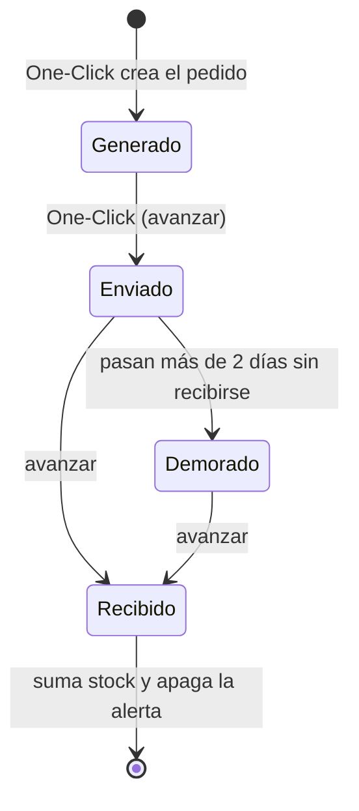
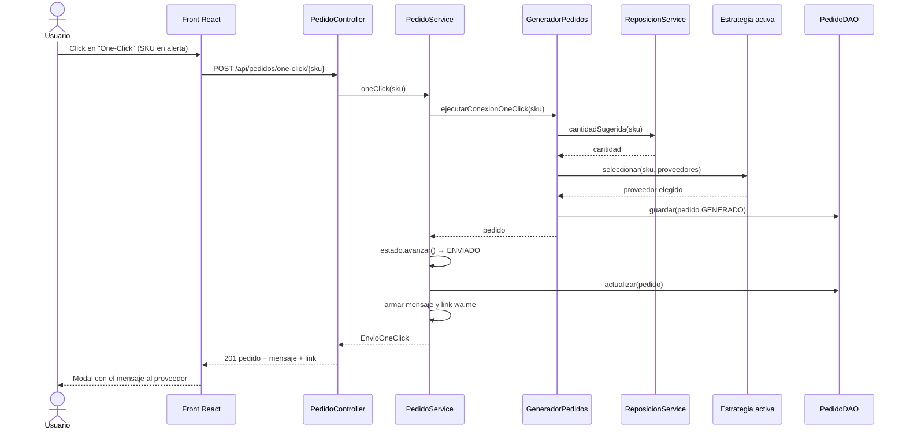
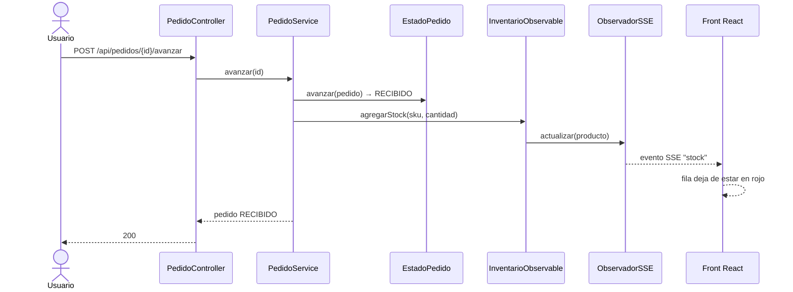

# State, API REST y One-Click

## Problema

Un pedido de reposición no es un dato estático: pasa por etapas y en cada una puede hacer cosas distintas. Un pedido recién generado todavía no salió, uno enviado puede atrasarse y uno recibido ya no admite más cambios. Resolverlo con un `if/else` sobre un `String` repartido por los controladores haría que cada regla nueva toque código ajeno.

## State: el ciclo de vida del pedido

Cada etapa es una clase que sabe a cuál sigue. `PedidoService` es el contexto: le pide al estado actual que avance y no conoce las reglas de cada etapa.



| Estado | `avanzar()` | `evaluar()` |
| :--- | :--- | :--- |
| `Generado` | Pasa a `ENVIADO` y registra `fechaEnvio` | - |
| `Enviado` | Pasa a `RECIBIDO` y registra `fechaRecepcion` | Pasa a `DEMORADO` si pasaron más de 2 días desde el envío |
| `Demorado` | Pasa a `RECIBIDO` y registra `fechaRecepcion` | - |
| `Recibido` | Error: el pedido ya fue recibido | - |

El estado se guarda en `PedidoReposicion.estado` como texto (`GENERADO`, `ENVIADO`, `DEMORADO`, `RECIBIDO`) y `EstadoPedido.de(nombre)` lo convierte de nuevo en objeto. Así no hubo que tocar `model/`.

`evaluar()` es la regla de la demora: se ejecuta al listar los pedidos, así que el pasaje a `DEMORADO` no depende de ningún proceso en segundo plano.

### Qué pasa al recibir

Al llegar a `RECIBIDO`, `PedidoService` llama a `InventarioObservable.agregarStock(...)`. El inventario persiste el stock nuevo y avisa a los observadores: el `ObservadorSSE` emite un evento `stock` con el valor actualizado y, como ya no está por debajo del umbral, el front apaga la fila roja. También se registra un `Movimiento` de tipo `RECEPCION`.

## Diagrama de secuencia: One-Click



## Diagrama de secuencia: recepción del pedido



## One-Click: el mensaje

El One-Click no solo crea el pedido: lo deja `ENVIADO` y arma el texto para el proveedor con el SKU y la cantidad calculada por `ReposicionService` (la cantidad del ejemplo es ilustrativa).

```text
Hola Distribuidora del Sur, necesitamos reponer stock. Pedido #1: SKU CERV-X (Cerveza X 1 L) - 238 unidades. Por favor confirmar disponibilidad y fecha de entrega. Gracias, Nexus Software.
```

La respuesta incluye además un link `https://wa.me/<teléfono>?text=<mensaje>` con el contacto del proveedor. El envío es una simulación: el link solo abre la conversación con el mensaje precargado.

## Estrategia

`PUT /api/estrategia` con `{"perfil": "PRECIO" | "VELOCIDAD" | "BALANCEADA"}` cambia la estrategia de `GeneradorPedidos` con `setEstrategia()`. Los controladores no saben cómo se elige el proveedor, solo delegan.

## Demo: ver el estado Demorado sin esperar

Dos días reales no entran en un video. `POST /api/pedidos/{id}/simular-demora` retrocede la fecha de envío de un pedido `ENVIADO` más allá del plazo y lo deja `DEMORADO` usando la misma regla de `Enviado.evaluar()`. Después, `avanzar` lo pasa a `RECIBIDO`.

Flujo de la demo: venta → fila roja → One-Click → cambio de estrategia → simular demora → avanzar → fila deja de estar en rojo.

## Errores

Todas las respuestas de error tienen la forma `{"error": "mensaje"}`, armadas en `ManejadorErrores`.

| Excepción | Código | Cuándo |
| :--- | :--- | :--- |
| `IllegalArgumentException`, `StockInsuficienteException` | 400 | Venta inválida, sin stock, perfil de estrategia desconocido |
| `NoSuchElementException` | 404 | Pedido o producto inexistente |
| `IllegalStateException` | 409 | Pedido ya recibido, `simular-demora` sobre un pedido que no está `ENVIADO`, o One-Click cuando no hace falta reponer |

## Limitaciones

- El estado es un `String` en la entidad porque `model/` es compartido; los estados se reconstruyen con `EstadoPedido.de()`.
- La demora se detecta al consultar los pedidos, no en el momento exacto en que se cumple el plazo.
- El mensaje al proveedor se arma y se simula, sin integración real con una plataforma de mensajería.
