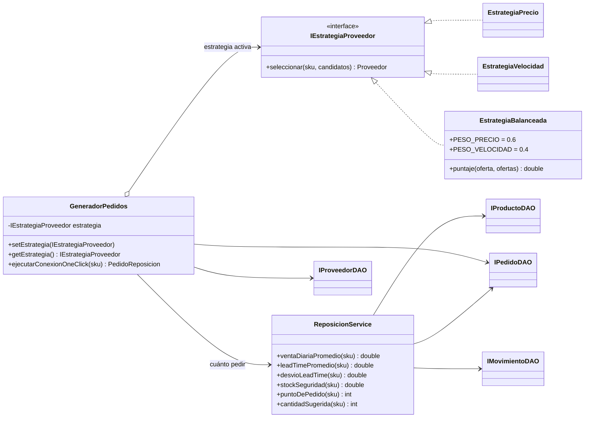

# Strategy y punto de pedido dinámico (ROP)

**Autor:** Brian Michelin

## Problema

Cuando un producto baja de su umbral hay que responder dos preguntas: **a quién** pedirle y
**cuánto** pedir. La primera depende de lo que priorice la distribuidora en ese momento (precio,
rapidez o un equilibrio). La segunda depende de cuánto se vende y de cuánto tardan los proveedores,
y de cuánto se atrasan. Un `if/else` por perfil dentro del generador de pedidos y un umbral fijo
resuelven el caso de hoy, pero no aguantan un perfil nuevo ni un proveedor que se atrasa.

## Strategy: a quién pedirle

- `IEstrategiaProveedor` define `seleccionar(sku, candidatos)`.
- Cada perfil es una estrategia concreta: `EstrategiaPrecio`, `EstrategiaVelocidad` y
  `EstrategiaBalanceada`. Esta última no estaba en el UML del PDF, aunque el informe la pide.
- `GeneradorPedidos` es el contexto: guarda la estrategia activa, `setEstrategia()` la cambia en
  caliente y `ejecutarConexionOneClick(sku)` la usa sin saber cuál es.



| Perfil | Clase | Elige | Si empatan |
| :--- | :--- | :--- | :--- |
| Precio | `EstrategiaPrecio` | La oferta más barata | Gana el de menor lead time |
| Velocidad | `EstrategiaVelocidad` | El menor lead time declarado | Gana el más barato |
| Balanceada (por defecto) | `EstrategiaBalanceada` | El menor puntaje 60% precio + 40% velocidad | Gana el primero de la lista |

Las tres descartan a los candidatos que no ofrecen el producto y lanzan `NoSuchElementException`
si no queda ninguno.

**Agregar un perfil** es escribir una clase nueva que implemente la interfaz. `GeneradorPedidos`
no se toca, y eso es lo que justifica el patrón frente a un `switch` por perfil.

### Puntaje de la estrategia balanceada

Precio y lead time no se pueden sumar directo (uno está en pesos y el otro en días), así que
primero se llevan a una escala de 0 a 1 entre los candidatos del producto:

```
precio_norm = (precio - precio_min) / (precio_max - precio_min)
lead_norm   = (lead - lead_min)     / (lead_max - lead_min)
puntaje     = 0.6 · precio_norm + 0.4 · lead_norm
```

Un puntaje de 0 es la oferta más barata y más rápida; uno de 1, la peor en ambas. Si todos los
candidatos empatan en un criterio, ese criterio vale 0 para todos y decide el otro.

## ROP dinámico: cuándo y cuánto pedir

```
ROP = d · L + SS        SS = z · σL · d
```

| Símbolo | Qué es | Cómo se calcula | Método |
| :--- | :--- | :--- | :--- |
| d | Venta diaria promedio | Ventas desde las 0 h de hace 30 días (incluye las de hoy) / 30 | `ventaDiariaPromedio` |
| L | Lead time promedio | Promedio de `fechaRecepcion - fechaEnvio` de los pedidos `RECIBIDO`. Sin historial, promedio de los lead times de las ofertas | `leadTimePromedio` |
| σL | Desvío de las demoras | Desvío estándar muestral (n - 1) de esos mismos lead times; 0 con menos de dos entregas | `desvioLeadTime` |
| z | Factor de nivel de servicio | 1.65 (95%) por defecto, configurable por constructor | - |
| SS | Stock de seguridad | z · σL · d | `stockSeguridad` |
| ROP | Punto de pedido | d · L + SS, redondeado a unidades | `puntoDePedido` |

`d · L` es lo que se vende mientras el pedido viaja. `SS` es el colchón para seguir vendiendo si
el proveedor se atrasa: cuanto más irregulares son las entregas (σL más grande), antes se pide.

### Cantidad sugerida

```
posición = stock actual + unidades de pedidos todavía no recibidos
si posición > ROP  → 0 (no hace falta pedir)
si no              → Q = ROP + 7 · d - posición
```

- **Posición en vez de stock:** si ya hay un pedido en camino, apretar One-Click otra vez no
  duplica el pedido.
- **7 días de cobertura:** el pedido deja el stock en el ROP más una semana de venta, así se
  repone una vez por semana, como en el historial de entregas.

`ejecutarConexionOneClick(sku)` junta las dos partes: calcula Q, elige el proveedor con la
estrategia activa y guarda el pedido en estado `GENERADO`. Si Q es 0 lanza `IllegalStateException`.

## Ejemplo numérico: Cerveza X

### ¿A quién se le pide?

Las cuatro ofertas de `CERV-X` en los datos de prueba, con el precio normalizado sobre
$900 a $1150 y el lead time sobre 1 a 6 días:

| Proveedor | Precio | Lead time | Precio norm. | Lead norm. | Puntaje 60/40 | Lo elige |
| :--- | ---: | ---: | ---: | ---: | ---: | :--- |
| Distribuidora del Sur | $900 | 6 días | 0.00 | 1.00 | 0.400 | Precio |
| Bebidas Express | $1150 | 1 día | 1.00 | 0.00 | 0.600 | Velocidad |
| Mayorista Central | $990 | 3 días | 0.36 | 0.40 | **0.376** | Balanceada |
| Logística Norte | $980 | 5 días | 0.32 | 0.80 | 0.512 | - |

Mismo producto, tres estrategias, tres proveedores distintos. Central no es el más barato ni el
más rápido, pero no es malo en nada; Sur pierde la balanceada por sus 6 días de demora.

### ¿Cuándo y cuánto?

En los últimos 30 días se vendieron 663 unidades, y las 8 entregas del historial tardaron 3, 8,
4, 1, 3, 7, 5 y 7 días.

```
d   = 663 / 30                         = 22.1 unidades por día
L   = 38 / 8                           = 4.75 días
σL  = √(41.5 / 7)                      ≈ 2.43 días
SS  = 1.65 · 2.43 · 22.1               ≈ 88.8 unidades
ROP = 22.1 · 4.75 + 88.8 = 105 + 88.8  ≈ 194 unidades
```

- Con el stock inicial de 220 no se pide: 220 > 194.
- Si una venta lo deja en 110 (la fila se pone roja porque el umbral es 120):
  `Q = 194 + 7 · 22.1 - 110 = 194 + 155 - 110 = 239 unidades`.
- Con el perfil balanceado, el One-Click genera el pedido de 239 unidades a Mayorista Central.

### Todos los productos de la demo

| SKU | d | L | σL | SS | ROP | Stock inicial | Umbral crítico | Ya está bajo el ROP |
| :--- | ---: | ---: | ---: | ---: | ---: | ---: | ---: | :---: |
| `CERV-X` | 22.10 | 4.75 | 2.43 | 88.8 | 194 | 220 | 120 | no |
| `CERV-RUB` | 35.27 | 3.50 | 2.08 | 121.1 | 245 | 260 | 120 | no |
| `GAS-COLA` | 29.50 | 3.50 | 1.29 | 62.8 | 166 | 220 | 100 | no |
| `GAS-LIMA` | 14.50 | 4.00 | 2.00 | 47.8 | 106 | 90 | 50 | sí |
| `AGUA-SG` | 41.27 | 2.50 | 1.73 | 117.9 | 221 | 300 | 130 | no |
| `AGUA-CG` | 12.00 | 4.33 | 2.31 | 45.7 | 98 | 48 | 40 | sí |
| `LIC-VOD` | 4.50 | 4.33 | 3.21 | 23.9 | 43 | 40 | 20 | sí |
| `LIC-WHI` | 3.00 | 5.00 | 3.61 | 17.8 | 33 | 25 | 15 | sí |

En todos los productos el ROP queda por encima del umbral crítico. Hay dos consecuencias:

- **El One-Click nunca queda vacío en la demo:** si la fila está roja, el stock ya está bajo el
  ROP y siempre hay algo para pedir. Hay un test que lo verifica.
- **El umbral fijo avisa tarde:** el agua con gas tiene 48 unidades y un umbral de 40, pero en los
  4.33 días que tarda un pedido se venden unas 52. Con el umbral fijo se pediría cuando ya no
  alcanza; el ROP lo detecta antes.

## Integración con la API

`ReposicionService` y `GeneradorPedidos` son Java plano, igual que `VentaService`. Los DAOs salen de
`PersistenciaConfig`:

```java
ReposicionService reposicion = new ReposicionService(productoDAO, proveedorDAO, pedidoDAO, movimientoDAO);
GeneradorPedidos generador = new GeneradorPedidos(proveedorDAO, pedidoDAO, reposicion);
```

| Endpoint | Llamada | Errores |
| :--- | :--- | :--- |
| `PUT /api/estrategia` | `generador.setEstrategia(new EstrategiaPrecio())` (o Velocidad, Balanceada) | Perfil desconocido → 400 |
| `POST /api/pedidos/one-click/{sku}` | `generador.ejecutarConexionOneClick(sku)` devuelve el `PedidoReposicion` guardado en `GENERADO` | `NoSuchElementException` → 404 · `IllegalStateException` (no hace falta reponer) → sugerido 409 |

- El mensaje al proveedor y el link `wa.me` se arman con `proveedorDAO.buscarPorId(pedido.getProveedorId())`.
- Las unidades en camino son las de los pedidos cuyo estado no es `RECIBIDO`. Si el State suma un
  estado terminal nuevo (por ejemplo, cancelado), hay que excluirlo de esa cuenta.
- **Para el video:** mientras el pedido de un producto no llegue, un segundo One-Click de ese mismo
  producto se rechaza. Para mostrar el cambio de estrategia, cambiar el perfil antes del One-Click
  o usar otro producto.

## Pruebas

| Clase | Pruebas | Qué cubre |
| :--- | ---: | :--- |
| `EstrategiaProveedorTest` | 9 | Las tres elecciones de Cerveza X, los puntajes 0.400 / 0.600 / 0.376 / 0.512, desempates, candidatos sin oferta |
| `ReposicionServiceTest` | 16 | Caso armado (d = 10, L = 5, σL = 2 → SS = 33, ROP = 83), z configurable, sin historial, unidades en camino, ejemplo de Cerveza X |
| `GeneradorPedidosTest` | 10 | One-Click con cada estrategia sobre los datos de demo, pedido guardado, sin duplicados, errores |

## Limitaciones

- L y σL salen de las entregas de todos los proveedores del producto: miden la demora típica del
  producto, no la del proveedor que se termina eligiendo.
- La estrategia de velocidad compara el lead time declarado en la oferta, no el histórico.
- d es un promedio simple de 30 días: no contempla estacionalidad ni tendencia.
- z y la cobertura de 7 días son iguales para todos los productos. No se calcula un lote económico
  (EOQ) porque los datos no tienen costos de pedido ni de almacenamiento.
